# NEXUSFLOW Complete System Architecture Map & Visual Diagrams

**Repository:** `p:/DAA OPTIONAL` (Branch: `version4.0`)  
**Scope Snapshot:** `481` repository files (`88` root/docs/assets + `142` `client/` + `251` `server/`), `42` Mongoose models, `428` Express HTTP route declarations (`server/index.js` + `13` route modules), `8` files in `server/algorithms/`, `65` files in `server/services/`, `4` files in `server/socket/`, `106` test/utility scripts (`103` `server/scripts/` + `3` external).  
**Evidence Rule:** Components, endpoints, sockets, services, and data models documented below reflect actual inspected source code (`CODE VERIFIED`). Dead/unwired components and bypassed checks are explicitly marked `[UNWIRED]` / `[BYPASSED]`.

---

## 1. Layered Architectural Overview

NEXUSFLOW is an Expo / React Native Web client (`client/`) paired with an Express + Socket.IO + MongoDB/Mongoose backend (`server/`). Across four releases (`V1` → `V2` → `V3` → `V4`), it evolved from a single-workspace DAA academic showcase into a multi-methodology project intelligence platform supporting **Waterfall**, **Scrum**, **Kanban**, **Classic (V1/V3 alias)**, and backend **Hybrid** configs, powered deterministically by DAA engines and advisories via the `$0`-cost **OmniRoute** cascade.

### Core Runtime Layers
1. **Presentation & Routing (`client/app/`, `client/components/`)**: `14` Expo Router screens dispatch into `client/app/team/[teamId].tsx`, which selects tabs and panels from `team.methodology`. `12` V4 workspace panel components have zero imports across `client/`.
2. **Client State & Transport (`client/hooks/`, `client/services/`, `client/utils/`)**: `10` React hooks (`useTeam`, `useTeams`, `useTeamTasks`, `useChat`, `useDependencyGraph`, `useInvitations`, `useRecommendation`, `useReminders`, `useTaskAnalytics`, `useWaterfallPlanLifecycle`), `client/utils/api.ts`, `client/services/scrumApiService.ts`, `kanbanApiService.ts`, `socket.ts`, and `client/utils/boyerMoore.ts`.
3. **Express HTTP Gateway & Socket.IO (`server/index.js`, `server/routes/`, `server/socket/`)**: `428` route declarations across `server/index.js` (`9`) and `13` routers (`projects.js` dual-mounted on `/api` and `/`), plus `4` Socket.IO room/event handlers (`taskHandlers.js`, `aiOrchestrator.js`, `projectSyncHandlers.js`, `chatHandlers.js`).
4. **Deterministic & AI Computation (`server/algorithms/`, `server/services/`, `server/utils/`)**: `8` core DAA modules (`greedyScheduler.js`, `taskPriorityEngine.js`, `graphTraversal.js`, `branchAndBound.js`, `taskOptimiser.js`, `decisionEngine.js`, `projectDecomposer.js`, `projectGuidanceEngine.js`), `sortAlgorithms.js` (`5` sorts), deterministic methodology engines (`phaseGateService.js`, `scrumEngine.js`, `kanbanEngine.js`, `hybridEngine.js`, `riskEngine.js`, `unifiedProjectHealthService.js`, `projectHealth2Service.js`), and `$0` LLM gateway (`omniRoute.js`).
5. **Persistence (`server/models/`)**: `42` Mongoose schemas with `timestamps: true`, `3` `pre` hooks (`User`, `Project`, `Task`), `0` `post` hooks, and `4` export-guarded models (`ProjectLesson`, `Risk`, `ScrumHealthSnapshot`, `ScrumSprintSnapshot`).

---

## 2. Diagram 1 — System Context & Deployment Topology (`CODE VERIFIED`)

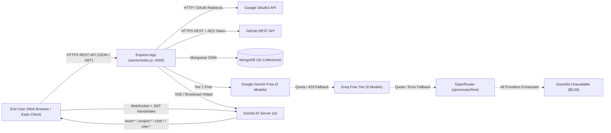

---

## 3. Diagram 2 — Authentication, JWT & Google OAuth Flow (`CODE VERIFIED`)

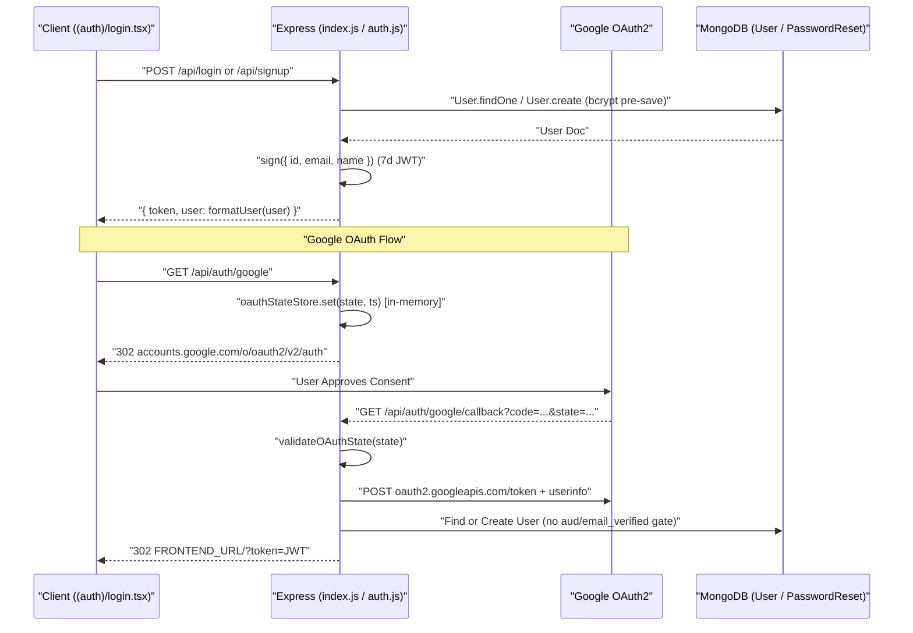

---

## 4. Diagram 3 — Express Request & Authorization Pipeline (`CODE VERIFIED`)

`server/index.js:44–242` mounts global CORS, `15mb` JSON parser, auth handlers, and `13` routers—without global `express-rate-limit` (`server/utils/rateLimiter.js` is not globally attached).

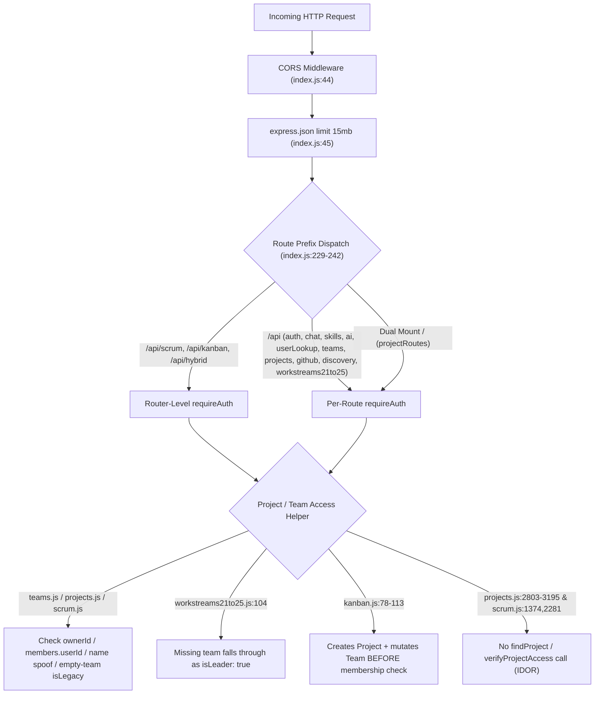

---

## 5. End-to-End Screen-to-Database Request & Data Flows (`CODE VERIFIED`)

| Flow | Frontend Screen & Component | Client Hook / API | Server Route / Socket | Service / Algorithm | Primary Mongoose Models |
| --- | --- | --- | --- | --- | --- |
| **Workspace Shell Load** | `app/team/[teamId].tsx` | `useTeam` → `api.ts` | `GET /api/teams/:id` (`teams.js`) | `verifyTeamAccess`, task counts | `Team`, `Project`, `Task` |
| **Waterfall Overview & Phases** | `OverviewPanel.tsx`, `WaterfallPhaseCanvas.tsx`, `PhaseGateModal.tsx` | `useWaterfallPlanLifecycle` | `/api/projects/:id/overview`, `/phases/*`, `/phase-gate` (`projects.js`) | `phaseGateService.js`, `changeImpactService.js`, `eventService.js` | `Project`, `Task`, `Decision`, `ProjectEvent` |
| **Waterfall Plan & Decompose** | `PlanPanel.tsx` | `useWaterfallPlanLifecycle` | `POST /api/projects/:id/plan/*` (`projects.js`) | `omniRoute.js` (if LLM), `taskDecomposer.js`, `projectDecomposer.js` | `Project`, `Task`, `ProjectMemory` |
| **Waterfall Insights** | `WaterfallInsightsPanel.tsx` (`5` subtabs) | `useTeamTasks`, `api.ts` | `/health-v2`, `/lessons*`, `/capability-overview`, `/risks`, `/decisions/explain/*` (`workstreams21to25.js`, `projects.js`) | `projectHealth2Service.js`, `projectLearningService.js`, `capabilityIntelligenceService.js`, `riskEngine.js` | `TeamHealth`, `EarlyWarning`, `ProjectLesson`, `CapabilityProfile`, `Risk`, `DecisionRecord` |
| **Project AI & Guidance** | `ProjectAdvisorPanel.tsx`, `GuidancePanel.tsx`, `DecisionPanel.tsx` | `api.ts`, `socket.ts` | `POST /api/ai/*`, `/api/projects/:id/chat`, `task:decompose` | `omniRoute.js`, `workspaceContextService.js`, `decisionEngine.js`, `projectGuidanceEngine.js` | `AIConversation`, `AIMessage`, `Decision`, `Recommendation`, `TemporaryContext` |
| **Scrum Sprint Lifecycle** | `ScrumOverviewPanel`, `ScrumSetupPlanPanel`, `ScrumTasksPanel`, `ScrumInsightsPanel`, `ScrumRetroPanel` | `scrumApiService.ts` | `/api/scrum/*` (`scrum.js`) | `scrumEngine.js`, `scrumPlanningService.js`, `scrumHealthService.js`, `scrumAnalyticsService.js`, `scrumCapacityEngine.js`, `retrospectiveService.js` | `Sprint`, `Task`, `ScrumHealthSnapshot`, `ScrumSprintSnapshot`, `Retrospective` |
| **Kanban Flow & Policies** | `KanbanOverviewPanel`, `KanbanBoardPanel`, `KanbanBacklogPanel`, `KanbanFlowPanel`, `KanbanTeamPanel`, `KanbanInsightsPanel`, `KanbanPoliciesPanel` | `kanbanApiService.ts` | `/api/kanban/*` (`kanban.js`) | `kanbanEngine.js`, `kanbanWipService.js`, `kanbanFlowMetricsService.js`, `kanbanBottleneckService.js`, `kanbanForecastService.js`, `kanbanHealthService.js` | `Project.kanbanConfig`, `Task`, `ProjectEvent`, `ProjectMemory` (buggy schema) |
| **Classic V1 DAA Workspace** | `ClassicOverviewPanel`, `ClassicTasksPanel`, `ClassicSprintPanel`, `GraphPanel`, `ClassicMembersPanel`, `ChatPanel` | `useTeamTasks`, `useRecommendation`, `useDependencyGraph`, `useChat` | `/api/teams/:id/tasks*`, `/recommend`, `/assign`, `/chats*`, socket `task:*` | `greedyScheduler.js`, `sortAlgorithms.js`, `taskOptimiser.js` (0/1 Knapsack), `graphTraversal.js` (Kahn's), `branchAndBound.js` | `Team`, `Task`, `ChatMessage` |
| **GitHub OAuth & Repo AI** | `GitHubPanel.tsx` | `api.ts` | `/api/github/*` (`github.js`) | `githubService.js` (AES-256-CBC), `repositoryIndexingService.js`, `workspaceContextService.js`, `omniRoute.js` | `OAuthState`, `GitHubCredential`, `GitHubIntegration`, `RepositoryIndex`, `Project` |
| **Team Discovery & Apply** | `DiscoverTeamsModal.tsx`, `ApplyRoleModal.tsx`, `LeaderApplicationsPanel.tsx` | `api.ts`, `useInvitations` | `/api/discovery/*` (`discovery.js`), `/api/invitations/*` (`teams.js`) | `applicationService.js`, `invitationService.js` | `Team`, `TeamApplication`, `TeamApplicationAudit`, `Invitation`, `Notification` |

---

## 6. Diagram 4 — GitHub OAuth & Repository Intelligence Sequence (`CODE VERIFIED`)

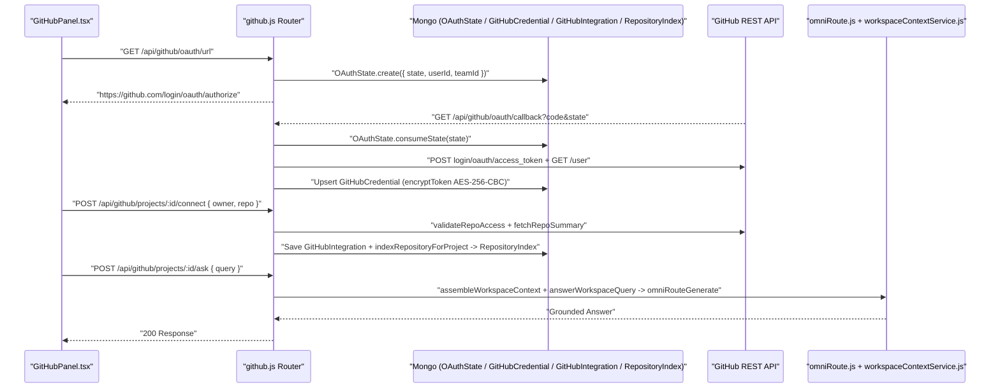

---

## 7. Diagram 5 — Socket.IO Room & Broadcast Topology (`CODE VERIFIED`)

Client (`client/services/socket.ts`) connects using WebSocket transport with handshake JWT (`socket.handshake.auth.token`). On connect (`server/index.js:256–268`), the server automatically joins `user:${userId}` and `user:${email}` + `chat:global`.

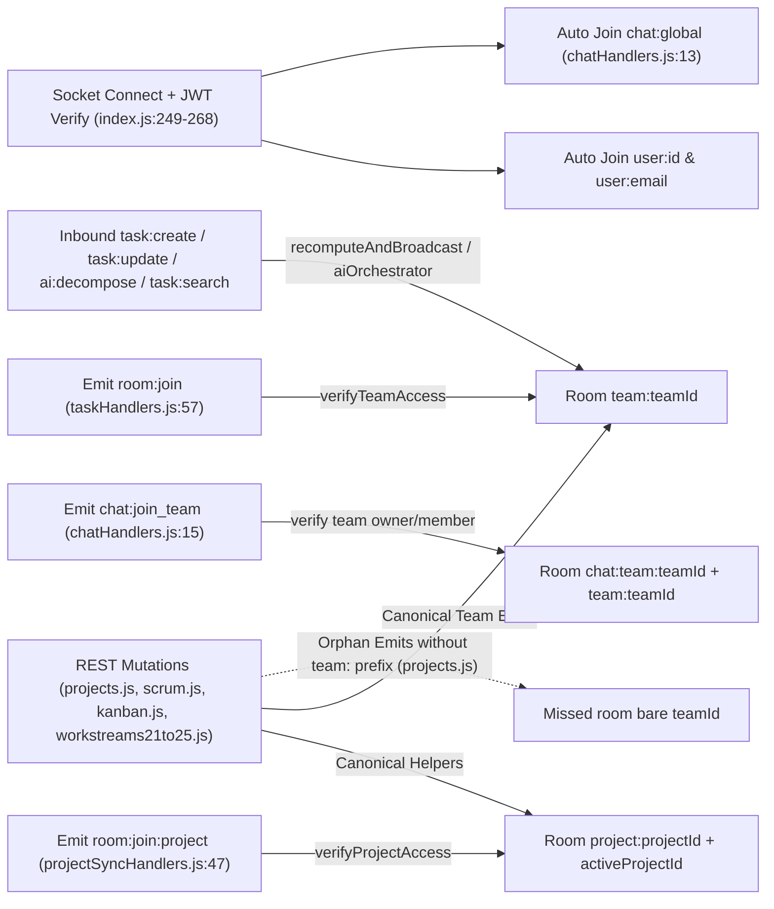

**Verified Socket Handler Groups:**
- `server/socket/taskHandlers.js`: `room:join`, `room:leave`, `task:create`, `task:update`, `task:delete`, `task:reorder`, deadline/phase notifications, emits `task:execution-order` & `project:health:updated` / `project:risk:updated`.
- `server/socket/aiOrchestrator.js`: `ai:decompose`, `ai:assign`, `ai:recommend`, `ai:chat`, `task:search` (uses `streamMock()` fallback in `@ai` chat paths).
- `server/socket/projectSyncHandlers.js`: `room:join:project`, `room:leave:project`; exports `broadcastDecisionUpdate`, `broadcastResearchUpdate`, `broadcastArchitectureUpdate`, `broadcastGuidanceUpdate`, `broadcastOpinionUpdate`, `broadcastRiskUpdate`, `broadcastHealthUpdate`, etc.
- `server/socket/chatHandlers.js`: `chat:join_team`, `chat:leave_team`, `chat:global:send`, `chat:team:send` (`chat:global:new`, `chat:team:new`).

---

## 8. Diagram 6 — Workspace Shell Methodology Router (`client/app/team/[teamId].tsx`) (`CODE VERIFIED`)

`client/app/team/[teamId].tsx:155–206, 304–526` resolves `team.methodology` and dynamically swaps navigation tabs and content panels. Notice `NEXUSFLOW` / `V3` alias into `isClassic`, `KANBAN` omits its WIP banner (`L305` negates `!isKanban`), and unmapped `HYBRID` falls through to Waterfall panels while showing `MethodologyWipBanner`.

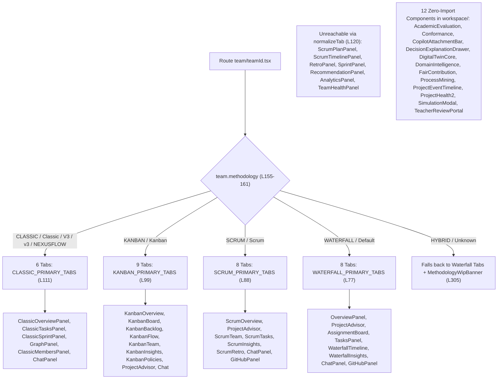

---

## 9. Diagram 7 — Waterfall Plan-to-Tasks & 6-Phase Gate State Machine (`CODE VERIFIED`)

Waterfall phase progression (`projects.js` + `phaseGateService.js` + `taskHandlers.js` + `OverviewPanel` / `WaterfallPhaseCanvas` / `PhaseGateModal` / `ChangeImpactModal`) enforces sequential phase gates before downstream tasks can execute.

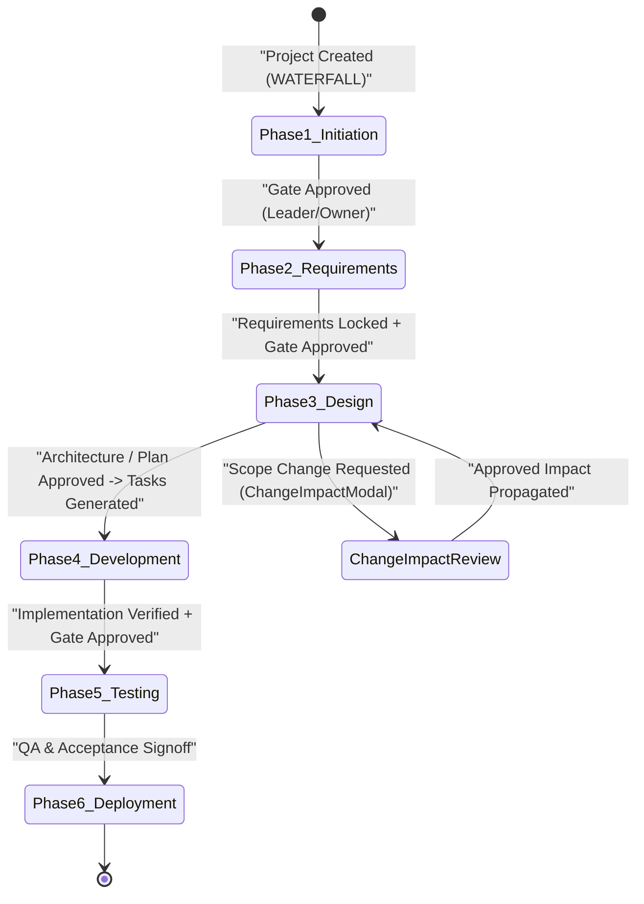

---

## 10. Diagram 8 — Scrum Sprint Lifecycle & Completion Safety FSM (`CODE VERIFIED`)

Scrum execution (`scrum.js` + `scrumEngine.js` + `ScrumOverviewPanel` / `ScrumTasksPanel` / `ScrumInsightsPanel`) enforces V4 sprint completion safety (`HTTP 409` warning when incomplete tasks remain in To Do / In Progress / In Review / Blocked rather than silently stripping `sprintId`).

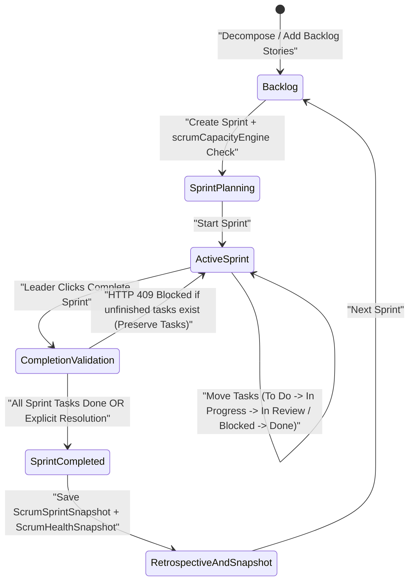

---

## 11. Diagram 9 — Kanban Continuous Flow & WIP Policy Pipeline (`CODE VERIFIED`)

Kanban execution (`kanban.js` + `kanbanEngine.js` + `kanbanWipService.js` + `kanbanReactiveEngine.js`) enforces continuous pull limits across configurable `Project.kanbanConfig.workflowColumns`. Note: `kanbanWipService.js:37–38` currently flags `count >= limit` as overloaded, and `kanban.js:192, 203` contains a duplicate `$or` key overwrite leaking cross-project backlog queries.

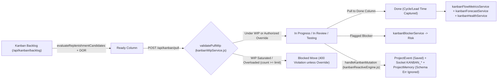

---

## 12. Diagram 10 — Classic V1 DAA Engine Pipeline (`CODE VERIFIED`)

Classic workspaces (`CLASSIC_PRIMARY_TABS` + `/api/teams/*` + `taskHandlers.js` + `aiOrchestrator.js`) showcase five foundational DAA algorithms deterministically with zero LLM dependency:

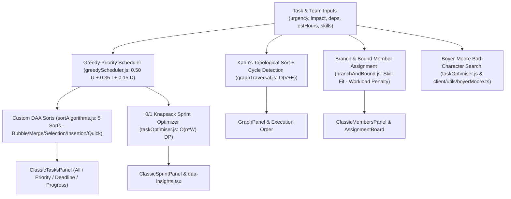

---

## 13. Diagram 11 — Hybrid Engine Backend vs Frontend Execution Gap (`CODE VERIFIED`)

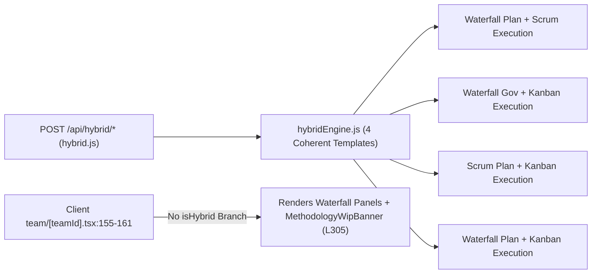

---

## 14. Diagram 12 — AI Cascade (`omniRoute.js`), Mock Stub & Socket Fallback (`CODE VERIFIED`)

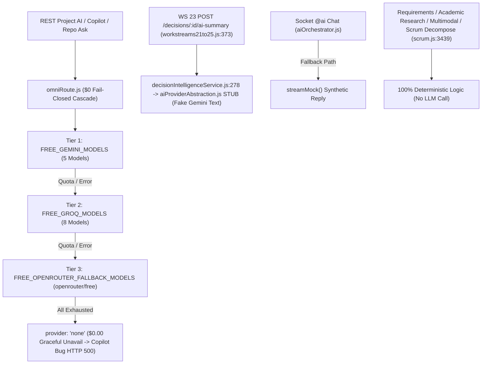

---

## 15. Diagram 13 — 42-Model MongoDB ER Map by Domain Cluster (`CODE VERIFIED`)

```mermaid
erDiagram
    USER ||--o{ TEAM : owns
    USER ||--o{ SKILL_VERIFICATION : verifies
    USER ||--o{ GITHUB_CREDENTIAL : authorizes
    USER ||--o{ PASSWORD_RESET : requests
    TEAM ||--o{ PROJECT : hosts
    TEAM ||--o{ INVITATION : sends
    TEAM ||--o{ TEAM_APPLICATION : receives
    TEAM ||--o{ CHAT_MESSAGE : discusses
    TEAM ||--o{ TEAM_DEPARTURE : records
    PROJECT ||--o{ TASK : contains
    PROJECT ||--o{ SPRINT : plans
    SPRINT ||--o{ TASK : scopes
    TASK ||--o{ TASK : depends_on

    PROJECT ||--o{ RESEARCH_ITEM : gathers
    PROJECT ||--o{ ARCHITECTURE_COMPONENT : defines
    PROJECT ||--o{ RESOURCE : stores
    PROJECT ||--o{ AI_CONVERSATION : opens
    AI_CONVERSATION ||--o{ AI_MESSAGE : logs
    PROJECT ||--o{ TEMPORARY_CONTEXT : buffers

    PROJECT ||--o{ GITHUB_INTEGRATION : binds
    PROJECT ||--o{ REPOSITORY_INDEX : indexes
    OAUTH_STATE }o--|| USER : csrf_binds

    PROJECT ||--o{ DECISION : tracks
    DECISION ||--o{ DECISION_FEEDBACK : receives
    PROJECT ||--o{ DECISION_RECORD : explains
    PROJECT ||--o{ RECOMMENDATION : stores
    PROJECT ||--o{ OPINION : records
    PROJECT ||--o{ RISK : monitors
    PROJECT ||--o{ EARLY_WARNING : alerts
    PROJECT ||--o{ PROJECT_MEMORY : remembers
    PROJECT ||--o{ PROJECT_EVENT : emits
    PROJECT ||--o{ PROJECT_LESSON : learns
    PROJECT ||--o{ LEARNING_INSIGHT : extracts

    PROJECT ||--o{ TEAM_HEALTH : snapshots
    PROJECT ||--o{ SCRUM_HEALTH_SNAPSHOT : snapshots
    PROJECT ||--o{ SCRUM_SPRINT_SNAPSHOT : snapshots
    PROJECT ||--o{ CAPABILITY_PROFILE : profiles
    PROJECT ||--o{ RETROSPECTIVE : reviews
    PROJECT ||--o{ TEACHER_REVIEW : evaluates
    PROJECT ||--o{ ACADEMIC_RUBRIC : grades
    PROJECT ||--o{ CONTRIBUTION_DISPUTE : arbitrates
    TEAM_APPLICATION ||--o{ TEAM_APPLICATION_AUDIT : audits
    USER ||--o{ NOTIFICATION : notified_via
```

---

## 16. Diagram 14 — Health 2.0, Early Warnings, Risk & Learning Closed Loop (`CODE VERIFIED`)

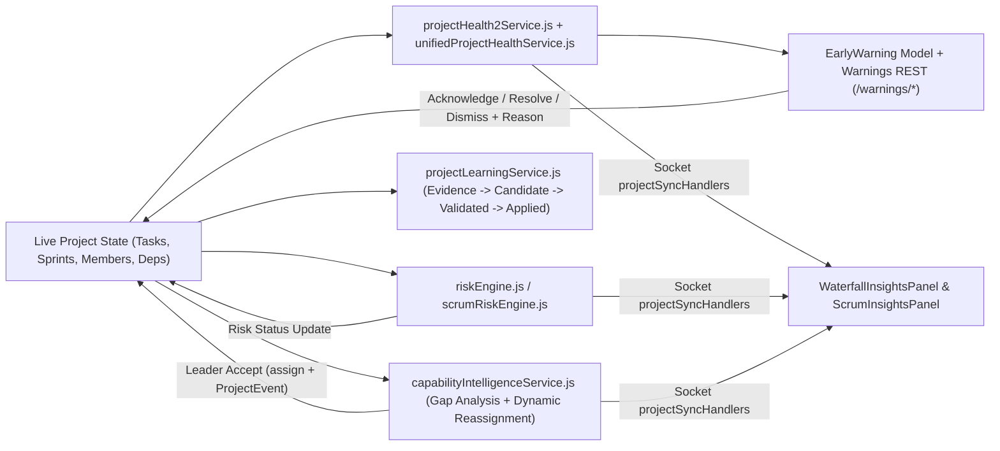

*(Note: In `unifiedProjectHealthService.js:491`, `requirementsDim` currently contributes `0.00` weight to the composite score despite appearing in the 9-dimension array.)*

---

## 17. Diagram 15 — Workstreams 11–25: Backend Services vs Mounted/Orphaned UI (`CODE VERIFIED`)

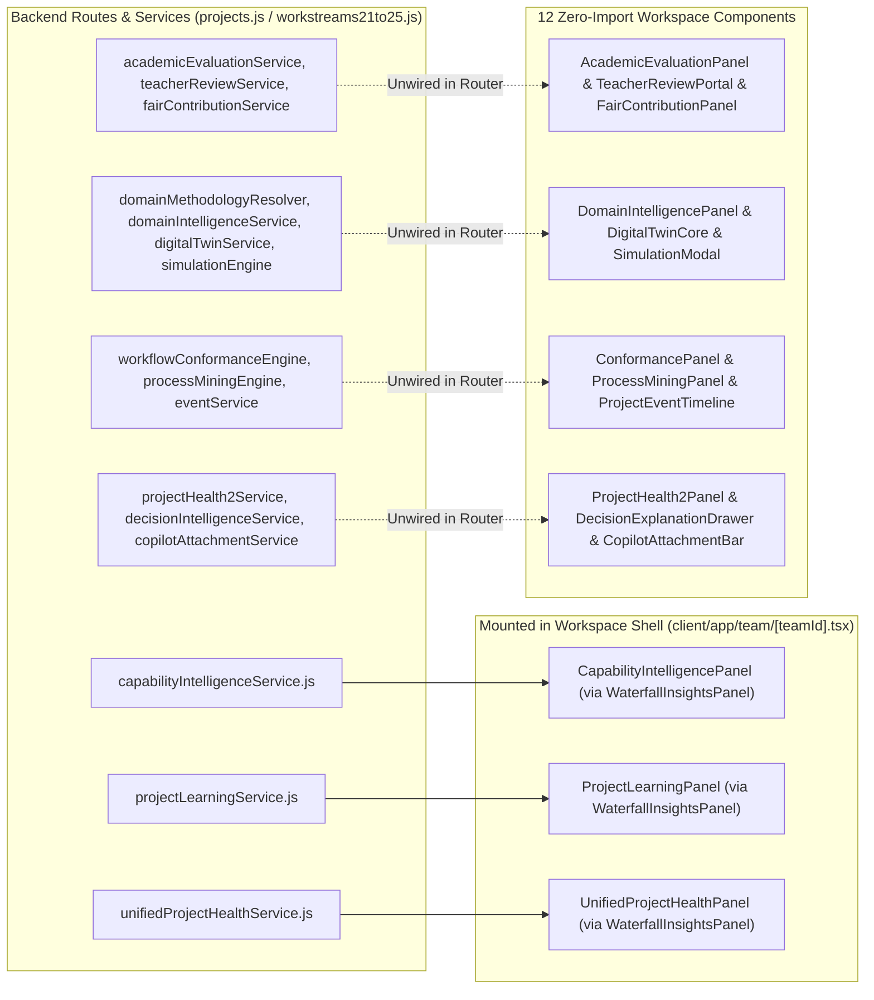

---

## 18. Diagram 16 — Trust Boundaries & Critical Attack Surface Map (`CODE VERIFIED`)

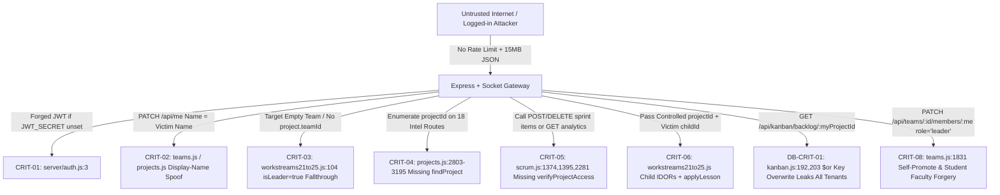

---

## 19. Cross-References

- Security vulnerabilities & defect remediations: [`NEXUSFLOW_TECHNICAL_RISKS.md`](./NEXUSFLOW_TECHNICAL_RISKS.md)
- Methodology & Phase 8 feature completion audit: [`NEXUSFLOW_FEATURE_STATUS.md`](./NEXUSFLOW_FEATURE_STATUS.md)
- Complete 428-endpoint REST & Socket reference: [`NEXUSFLOW_API_AND_SOCKET_REFERENCE.md`](./NEXUSFLOW_API_AND_SOCKET_REFERENCE.md)
- Complete 481-file repository inventory: [`NEXUSFLOW_FILE_INDEX.md`](./NEXUSFLOW_FILE_INDEX.md)
