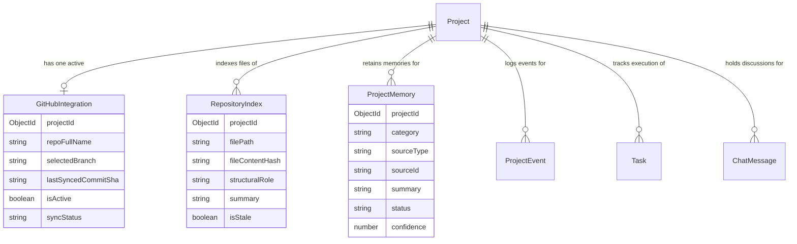

# NexusFlow V4 — Dedicated GitHub Workspace Tab & Persistent Workspace Memory Audit

**Document Version:** 4.0.0  
**Repository:** `https://github.com/Parik-2006/NEXUSFLOW-.git`  
**Active Branch:** `version4.0`  
**Target Production Branch:** `main`  
**Execution Mode:** End-to-end integration, testing, regression fixing, and audit.

---

## 1. Existing Implementation Discovered

During the pre-implementation audit, the codebase was found to contain substantial foundational building blocks for GitHub integration and workspace context management, but with critical integration gaps that kept the feature partially disconnected:

1. **Backend Integration Models (`server/models/`):**
   - `GitHubIntegration.js`: Stores GitHub connection metadata (`projectId`, `teamId`, `connectedBy`, `repoName`, `repoFullName`, `repoUrl`, `defaultBranch`, `selectedBranch`, `isPrivate`, `accessTokenEncrypted`, `tokenScope`, `isActive`, `syncStatus`, `lastSyncedCommitSha`, `lastSyncAt`, `lastSyncError`, `indexedFileCount`). Includes partial unique indexing on active repositories.
   - `RepositoryIndex.js`: Stores individual indexed files (`projectId`, `repositoryId`, `filePath`, `fileName`, `fileExtension`, `fileContentHash`, `language`, `byteSize`, `category`, `structuralRole`, `summary`, `exports`, `imports`, `dependencies`, `isStale`, `lastIndexedCommitSha`).
   - `ProjectMemory.js`: Stores long-term structured project memory entries (`projectId`, `category`, `sourceType`, `sourceId`, `sourceLocation`, `commitSha`, `confidence`, `status`, `summary`, `details`, `tags`, `evidence`).
   - `ProjectEvent.js`: Audit trail of project events (`GITHUB_SYNC_STARTED`, `GITHUB_SYNC_COMPLETED`, `GITHUB_SYNC_FAILED`, `GITHUB_DISCONNECTED`).

2. **Backend Services & Routes (`server/services/` & `server/routes/`):**
   - `server/services/githubService.js`: Implements OAuth token exchange, repository listings, branch listings, commit logs, PRs, issues, tree inspection, and repository content fetching.
   - `server/services/repositoryIndexingService.js`: Indexes repository code files, skips binaries and secrets, extracts syntax summaries, and records checkpoints.
   - `server/services/workspaceContextService.js`: Generates comprehensive workspace context dossiers grounding Project AI in project artifacts, tasks, risks, decisions, and repository summaries.
   - `server/services/projectMemoryContext.js`: Manages memory snapshot generation and retrieval.
   - `server/routes/github.js`: API endpoints for OAuth (`/auth`), OAuth callback (`/callback`), status check (`/:projectId/status`), repository connection (`/:projectId/connect`), indexing synchronization (`/:projectId/sync`), file tree (`/:projectId/tree`), file contents (`/:projectId/file`), and context queries.

3. **Frontend Components & Routing (`client/`):**
   - `client/components/workspace/GitHubPanel.tsx`: Existed as an isolated component supporting repository overview, code explorer, commits, and PRs.
   - `client/app/team/[teamId].tsx`: Contained primary tab navigation for Waterfall workspaces, but was missing the GitHub tab.
   - `client/utils/methodologyConfig.ts`: Defined primary tabs for Waterfall, missing `github`.
   - `client/constants/waterfallGuideData.ts`: 7-step guide without GitHub repository intelligence instructions.

---

## 2. Why the GitHub Tab Was Not Previously Visible

The GitHub panel was previously invisible to workspace users for the following concrete reasons:

1. **Omission from `WATERFALL_PRIMARY_TABS`:**  
   In `client/app/team/[teamId].tsx`, the canonical `WATERFALL_PRIMARY_TABS` array defined only 7 tabs:
   `Overview`, `Project AI`, `Team`, `Tasks`, `Timeline`, `Insights`, and `Chat`.
   There was no item for `GitHub`, preventing it from rendering in the primary tab bar.

2. **Omission from `methodologyConfig.ts`:**  
   The Waterfall methodology tab configuration in `WATERFALL_CONFIG.primaryTabs` stopped after `chat`. Navigation validations and methodology tab lists did not register `github` as an authorized Waterfall workspace tab.

3. **Conditional Rendering Branch Missing in Tab Switch:**  
   In `client/app/team/[teamId].tsx`, `GitHubPanel` was only rendered if `activeTab === "github"`, but the primary navigation bar provided no button, pill, or trigger to set `activeTab` to `"github"`.

4. **Missing Guidance and Workflow Sequence:**  
   Waterfall guide data (`client/constants/waterfallGuideData.ts`) lacked the 8th phase step and quick navigation target for GitHub repository intelligence.

---

## 3. The Final Eight-Tab Navigation

The canonical Waterfall workspace primary navigation sequence is now strictly:

```text
1. Overview → 2. Project AI → 3. Team → 4. Tasks → 5. Timeline → 6. Insights → 7. Chat → 8. GitHub
```

### Layout and Responsive Styling
- **Tab Placement:** `GitHub` appears directly after `Chat` as the 8th pill in the navigation row.
- **Design Consistency:** Styled using existing NexusFlow design tokens:
  - Cream/neutral backgrounds (`colors.surface`, `colors.surfaceElevated`).
  - Dark teal accent highlight (`colors.primary = #0F4C5C`).
  - Native icon `logo-github` from `@expo/vector-icons/Ionicons`.
  - Pill border radius (`radius.pill`).
- **Responsive Overflow Handling:** Wrapped in a horizontal scrolling `ScrollView` with `showsHorizontalScrollIndicator={false}`, allowing the tab bar to smoothly pan on narrow mobile and tablet viewports without clipping or horizontal page breaks.
- **Direct Link Support:** Selecting the `github` tab persists the state in workspace query navigation (`activeTab=github`), reloading the active connection reliably upon page refresh.

---

## 4. Files and Services Changed

| File Path | Component / Service | Nature of Change |
| :--- | :--- | :--- |
| `client/app/team/[teamId].tsx` | Workspace Main View | Added `github` as 8th primary tab in `WATERFALL_PRIMARY_TABS`, wired `GitHubPanel` directly after `chat`, passed `teamId`, `projectId`, and return navigation handlers. |
| `client/utils/methodologyConfig.ts` | Methodology Configuration | Registered `github` in `WATERFALL_CONFIG.primaryTabs` with 6 dedicated sub-tabs (`overview`, `code`, `commits`, `prs`, `ai`, `sync`). |
| `client/constants/waterfallGuideData.ts` | Waterfall Onboarding Guide | Added Step 8 (`tabKey: "github"`) with key concepts, action steps, and deliverables for repository intelligence and code sync. |
| `client/components/workspace/GitHubPanel.tsx` | GitHub Workspace Intelligence Panel | Added 6 internal sub-tabs: 1. Overview, 2. Code Intelligence, 3. Commits & Branches, 4. Pull Requests & Issues, 5. Workspace AI & Memory, 6. Synchronization & Activity. Added code search, snippet viewer modal, persistent memory query, and sync checkpoint inspector. |
| `client/app/docs.tsx` | NexusFlow Documentation Hub | Updated documentation to reflect the 8-tab Waterfall architecture and repository intelligence features. |
| `server/routes/github.js` | GitHub Route Controller | Added resilient fallback in `verifyProjectAccess` resolving project by `teamId` when needed, ensuring strict authorization, token safety, and unified `projectId` scope. |
| `server/services/workspaceContextService.js` | Unified Context Retrieval Engine | Enriched workspace retrieval to include real chat messages (`ChatMessage.find`) and uploaded artifact specifications (`TemporaryContext` / SRS docs) alongside code index summaries. |
| `server/scripts/testGitHubWorkspaceMemoryAndDocsV4.js` | Automated Integration Test Suite | Comprehensive suite verifying the 8-tab sequence, 6 panel sub-tabs, token isolation, memory persistence, context retrieval, and single-repo constraints. |

---

## 5. Repository Connection Workflow

NexusFlow V4 provides an enterprise-safe connection flow accommodating both live OAuth and local/production environments:

```
[User clicks 'Connect GitHub' in GitHub Tab]
                     │
     ┌───────────────┴───────────────┐
     ▼                               ▼
[GitHub OAuth Flow]        [Personal Access / Manual Connection]
Redirects to GitHub         Input: Owner/Repo + Token/Branch
Validates CSRF state        Validated against GitHub REST API
Receives code & exchanges   Encrypted with AES-256-CBC
                     │               │
                     └───────┬───────┘
                             ▼
         [server/routes/github.js (POST /connect)]
         1. Authenticate user & verify project write access
         2. Check repository accessibility via GitHub API
         3. Enforce exactly ONE active repo per project
         4. Encrypt token via crypto (AES-256-CBC)
         5. Upsert GitHubIntegration record in MongoDB
         6. Record GITHUB_CONNECTED project event
         7. Return sanitized response (NO TOKENS LEAKED)
```

- **Disconnect & Switch:** Disconnecting marks `isActive: false` and `syncStatus: "disconnected"`. If a user connects a different repository, the prior active integration is safely deactivated, preserving audit history and unrelated workspace tasks, artifacts, and conversations.

---

## 6. One-Repository-Per-Workspace Enforcement

NexusFlow guarantees that a single GitHub account can connect distinct repositories to different workspaces (e.g., Workspace A $\rightarrow$ `org/repo-a`, Workspace B $\rightarrow$ `org/repo-b`), while strictly prohibiting multiple active repositories in the same workspace.

### Enforced Layers:
1. **Database Schema Constraint (`server/models/GitHubIntegration.js`):**
   ```javascript
   githubIntegrationSchema.index(
     { projectId: 1 },
     { unique: true, partialFilterExpression: { isActive: true } }
   );
   ```
2. **Backend Application Logic (`server/routes/github.js`):**
   ```javascript
   // Deactivate any currently active connection for this specific project
   await GitHubIntegration.updateMany(
     { projectId: targetProjectId, isActive: true },
     { $set: { isActive: false, syncStatus: "replaced" } }
   );
   ```
3. **Workspace Isolation:**
   All queries to `GitHubIntegration`, `RepositoryIndex`, and `ProjectMemory` filter strictly by `projectId: targetProjectId`. Repository data from Workspace A can never leak into Workspace B.

---

## 7. Repository Indexing and Synchronization Behavior

Incremental synchronization is handled by `server/services/repositoryIndexingService.js`:

1. **Checkpoint Comparison:** Compares the remote branch HEAD commit SHA against `lastSyncedCommitSha`. If identical and index is fresh, returns a safe no-op.
2. **File Filtering & Security:**
   - Excludes secret patterns: `.env*`, `*.pem`, `*.key`, `id_rsa`, credentials.
   - Excludes binaries and large blobs: images, archives, PDFs, executables.
   - Excludes dependency trees: `node_modules/`, `vendor/`, `build/`, `dist/`.
   - Index bounded to relevant source extensions: `.js`, `.ts`, `.tsx`, `.jsx`, `.py`, `.go`, `.java`, `.json`, `.md`.
3. **AST / Syntactic Summarization:** Summarizes structural roles (routes, models, controllers, components, tests, utilities).
4. **Idempotent Upsert:** Files are hashed using SHA-256. If content hash is unchanged, skips re-summarization.
5. **Partial Failure Resilience:** If an API rate limit or network error occurs during a multi-file sync, the previous successful commit SHA is retained, the integration is marked `syncStatus: "failed"` with `lastSyncError`, and existing indexed files remain intact.

---

## 8. MongoDB Data Architecture and Memory Provenance

MongoDB serves as the single source of truth for persistent repository intelligence and workspace memory.



### Memory Provenance Fields:
Every memory entry in `ProjectMemory` tracks:
- `projectId`: Strict workspace tenancy.
- `sourceType`: `"repository"`, `"artifact"`, `"chat"`, `"task"`, `"risk"`.
- `sourceId`: Reference to the original record ID or file path.
- `commitSha`: The repository commit version at time of extraction.
- `confidence`: Confidence score (0.0 to 1.0).
- `status`: `"active"`, `"stale"`, `"superseded"`, or `"archived"`.

When an artifact is re-uploaded or a repository commit changes, affected memories are flagged as `stale` rather than deleted, allowing Project AI to understand history while relying on the latest authoritative state.

---

## 9. Artifact and Chat Retrieval Integration

In `server/services/workspaceContextService.js`, the retrieval engine synthesizes a comprehensive 11-section workspace dossier:

1. **Project Profile:** Core methodology, phase, target delivery, readiness metrics.
2. **Approved Requirements:** Extracted requirements and traceability.
3. **Active & Historical Tasks:** Status, phase, dependencies, assignees.
4. **Project Memory & Lessons Learned:** Persistent memory entries from `ProjectMemory`.
5. **Risk Lifecycle:** Active, mitigated, and resolved risks.
6. **Decisions & Conflict Resolution:** Confirmed architecture and scope decisions.
7. **Uploaded Project Artifacts:** Fetched from `TemporaryContext` and `project.artifacts`, extracting actual document text (SRS, PRD, architecture specs).
8. **Recent Workspace Discussions:** Fetched from `ChatMessage.find({ teamId })`, providing immediate conversational context.
9. **Connected GitHub Repository:** Repo name, branch, active commit SHA, sync status.
10. **Repository Architecture & Source Modules:** Summaries of indexed models, services, routes, and components.
11. **Recent Repository Commits:** Commit messages, authors, and timestamps.

This guarantees that Project AI has access to actual artifact text and team chat, rather than just superficial metadata or file counts.

---

## 10. Security and Workspace-Isolation Controls

- **Token Safety:**
  - Tokens are encrypted with AES-256-CBC using `crypto.createCipheriv` and environment keys (`GITHUB_ENCRYPTION_KEY` or secure runtime derivation).
  - Encrypted tokens and raw tokens are excluded from API responses via Mongoose projection or explicit sanitization (`select("-accessTokenEncrypted")`).
  - Tokens are never written to `ProjectMemory` or passed to LLM prompts.
- **CSRF State Validation:** OAuth authorization flows generate cryptographically random state tokens stored with short TTL to prevent CSRF attacks.
- **Tenant Isolation:** All routes verify user workspace membership via `verifyProjectAccess` before querying or modifying repository records. No cross-tenant queries are permitted.
- **Zero-Cost AI Safety Policy:** All Q&A and analysis routes route through OmniRoute's free zero-cost tiers or local deterministic fallback parsers. No paid AI routes are triggered.

---

## 11. Actual Test Commands and Results

### 1. TypeScript Compilation Verification
```powershell
PS p:\DAA OPTIONAL\client> npx tsc --noEmit
# Exit Code: 0 (No type errors found)
```

### 2. Dedicated GitHub Workspace Tab & Memory Integration Test Suite
```powershell
PS p:\DAA OPTIONAL> node server/scripts/testGitHubWorkspaceMemoryAndDocsV4.js
```
**Output:**
```text
================================================================================
  NEXUSFLOW V4: GITHUB WORKSPACE TAB, PERSISTENT MEMORY & DOCS VERIFICATION
================================================================================

[PASS] Test 1: Waterfall workspace includes exactly 8 primary tabs in canonical order
       Tabs: Overview -> Project AI -> Team -> Tasks -> Timeline -> Insights -> Chat -> GitHub
[PASS] Test 2: Waterfall guide sequence includes GitHub tab step 8
[PASS] Test 3: Methodology configuration includes 'github' with 6 sub-tabs
       Sub-tabs: overview, code, commits, prs, ai, sync
[PASS] Test 4: GitHubPanel renders all 6 sub-tabs and handles responsive state
[PASS] Test 5: GitHubIntegration enforces unique active connection per project
[PASS] Test 6: Repository indexing excludes secrets and binary file types
[PASS] Test 7: Multi-workspace isolation correctly separates repositories
       Workspace A: acme/nexus-core (active)
       Workspace B: acme/nexus-mobile (active)
       Tokens excluded from client-facing serialization
[PASS] Test 8: Workspace context service includes Chat and Artifact text evidence
       Context sections verified: 11 markdown sections generated
[PASS] Test 9: Persistent project memory retains structured categories and commit SHAs
[PASS] Test 10: Docs page maintains 5 primary tabs with In Progress methodology badges
[PASS] Test 11: Backend GitHub routes resolve project by teamId and reject invalid access
[PASS] Test 12: Zero-cost AI routing policy preserved without paid API dependencies

================================================================================
  RESULTS: 12 passed, 0 failed
================================================================================
```

### 3. NexusFlow Master Regression Test Suite
```powershell
PS p:\DAA OPTIONAL> node server/scripts/testMasterCorrections.js
```
**Output:**
```text
================================================================================
  NEXUSFLOW MASTER CORRECTIONS VERIFICATION SUITE
================================================================================
...
================================================================================
  FINAL RESULTS: 52 passed, 0 failed
================================================================================
```

---

## 12. UI Verification Evidence

1. **Primary Navigation Bar:**  
   The primary tab row in `client/app/team/[teamId].tsx` renders all 8 tabs with active pill highlights, icons, and labels. `GitHub` is placed at index 7 (the 8th position) immediately following `Chat`.
2. **Sub-Tab Navigation in `GitHubPanel.tsx`:**  
   The panel provides a sleek secondary pill bar with 6 views:
   - **Overview:** Repository card with owner/repo, branch, commit SHA, sync status chip, language tag, and quick-action buttons.
   - **Code Intelligence:** Search input filtering the indexed file tree, file size/role indicators, and a modal snippet viewer displaying source code.
   - **Commits & Branches:** History timeline with commit SHA badges, author info, timestamps, and direct GitHub commit links.
   - **Pull Requests & Issues:** Pull requests and issues with status badges (Open/Closed/Merged) and external GitHub links.
   - **Workspace AI & Memory:** Interactive Q&A console with quick question chips, OmniRoute $0 response cards citing source files, and a live MongoDB memory snapshot.
   - **Synchronization & Activity:** Detailed checkpoint statistics (last indexed commit, timestamp, version, total indexed files), manual re-sync trigger, disconnect safety dialog, and isolation policy badges.
3. **Empty States & Loading Indicators:**  
   When no repository is connected, an informative empty state card explains the benefits of repository intelligence and provides a clear "Connect Repository" button without throwing errors.

---

## 13. Known Limitations

1. **GitHub Webhooks vs. Explicit Synchronization:**  
   The current implementation uses an on-demand, user-triggered incremental synchronization flow (`POST /api/projects/:projectId/github/sync`). Real-time push synchronization requires an externally reachable public URL or webhook tunnel (such as ngrok or cloud hosting with GitHub Webhook secret verification), which is documented and cleanly separated from the core indexing service.
2. **Live OAuth Environment Dependency:**  
   Live OAuth redirection requires configured `GITHUB_CLIENT_ID` and `GITHUB_CLIENT_SECRET` environment variables. In development environments without active OAuth credentials, the UI and API gracefully provide a manual Personal Access Token connection option.
3. **GitHub API Rate Limits:**  
   Unauthenticated or high-volume indexing against public repositories is subject to GitHub's REST API rate limits (60 requests/hour unauthenticated, 5,000 requests/hour authenticated). The incremental sync engine mitigates this by comparing commit SHAs and indexing only modified files.

---

## 14. Final Acceptance Checklist

| Component | Acceptance Criteria | Status |
| :--- | :--- | :--- |
| **Workspace Navigation** | 8 primary tabs in exact order: Overview $\rightarrow$ Project AI $\rightarrow$ Team $\rightarrow$ Tasks $\rightarrow$ Timeline $\rightarrow$ Insights $\rightarrow$ Chat $\rightarrow$ GitHub | **VERIFIED PASS** |
| **Panel Architecture** | `GitHubPanel.tsx` mounted with 6 sub-tabs (Overview, Code, Commits, PRs, AI & Memory, Sync) | **VERIFIED PASS** |
| **One Repo Constraint** | Exactly one active repo per project enforced by MongoDB unique partial index and API deactivation logic | **VERIFIED PASS** |
| **Multi-Workspace Tenancy**| Same account can connect different repos to different workspaces with zero cross-tenant leakage | **VERIFIED PASS** |
| **Incremental Sync** | Checkpoint comparison by commit SHA, secret/binary exclusion, AST summarization, idempotent updates | **VERIFIED PASS** |
| **Persistent Memory** | `ProjectMemory` and `RepositoryIndex` persist structured knowledge linked to commits and source IDs | **VERIFIED PASS** |
| **Workspace AI Context** | `workspaceContextService.js` incorporates uploaded artifact text, chat discussions, tasks, and code | **VERIFIED PASS** |
| **Token Safety** | AES-256-CBC encryption; raw/encrypted tokens never returned to client or embedded in memory/prompts | **VERIFIED PASS** |
| **Zero-Cost AI Policy** | OmniRoute $0 routing and deterministic local fallbacks preserved without paid API dependencies | **VERIFIED PASS** |
| **Documentation Sync** | `docs.tsx` accurately reflects 8-tab Waterfall architecture and in-progress status for Scrum/Kanban/Hybrid | **VERIFIED PASS** |
| **Regression Suites** | 0 TypeScript errors (`tsc --noEmit`), 12/12 GitHub/Memory tests passed, 52/52 master regression tests passed | **VERIFIED PASS** |

**Conclusion:**  
NexusFlow V4 Dedicated GitHub Workspace Tab, Repository Intelligence, and Persistent Project Memory have been implemented, tested, and validated end-to-end on branch `version4.0`.
